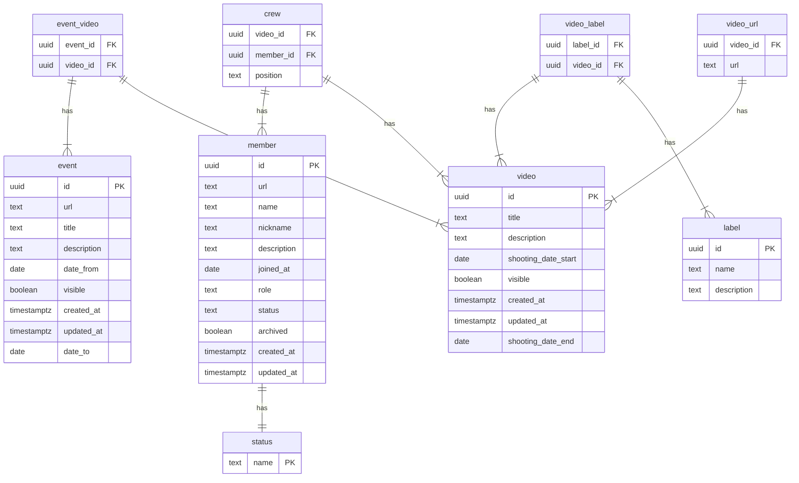

# Data module

This module holds all the interfaces
for every repository and their respective entities.

This module also holds the database migrations.

## Flyway migrations

The project uses [Flyway][flyway] for database migrations.
If you need to make any changes to the database schema,
you should create a new migration file in the
[`src/main/resources/db/migration`][migrations-folder]
directory.

- **Name it `V<n>__<description>.pgsql`.** `FlywayConfig` makes Flyway read `.pgsql` instead of `.sql`, because
  SonarCloud analyses every `.sql` file as Oracle PL/SQL and flags valid PostgreSQL.
- **Lint it.** The `Lint` workflow runs [Squawk][squawk], which flags migrations that would lock or rewrite a table,
  and [SQLFluff][sqlfluff], which checks the style and can fix it. They are pinned in [`lint/`][lint], with their
  config; run them from there with [uv][uv]:

  ```shell
  cd lint
  uv run squawk --no-error-on-unmatched-pattern '../server/data/src/main/resources/db/migration/*.pgsql'
  uv run sqlfluff fix ../server/data/src/main/resources/db/migration
  ```

  Check what `sqlfluff fix` changed before committing it. Where a rule doesn't apply, a `-- squawk-ignore-file`
  comment can turn it off for that migration, with a line saying why.

- **Never change a migration once it has been deployed.** Flyway checksums each migration it has run and refuses to
  start if one changes. Squawk leaves out V0 to V8, which were written before it. V9 changes the column types it
  flagged in them; the rest of its warnings are about how they changed the schema, which a later migration can't undo.

### Schemas

The project uses the `private` schema for all the tables.
The `public` schema is used for rendering views for the [GraphQL backend][graphql-backend].

## Batch fetching

`BatchFetchConfig` sets Hibernate's `hibernate.default_batch_fetch_size` to 100. Hibernate's default is to batch
nothing (except where `@BatchSize` asks for it), so every collection loads with its own query. A video's URLs are an
eager collection, so loading every video (about 2,300) ran 2,274 statements; with batches of 100 it runs 24.

- **What it changes:** every collection and lazy association, not only video URLs. When the code reaches one
  uninitialized collection, Hibernate loads up to 99 more of the same kind from the persistence context with it.
- **The trade-off:** a higher size means fewer queries, but each brings more rows into memory at once, and loads
  collections the code may not need. A lower size means more round trips. Here the mappers read every collection
  they load, so batching changes the number of queries, not the amount of data.
- **Why 100:** it is the largest page of the admin's lists, and a batch stays small, since a video has only a
  handful of URLs. Hibernate's docs give no number.

The KDoc of `BatchFetchConfig` has the details and links to Hibernate's docs. It is in code rather than in
`application.yml` so that the reason can sit next to it.

## Testing

The tests in this module will set up a Postgres database
with the help of [Testcontainers][testcontainers].

This means that you need docker running on your machine when running these tests

You can skip these tests during your local build using `-x :server:data:test`

```shell
# run all tests except :server:data
./gradlew -x :server:data:test test
```

Since the project is so well-structured,
there's no need to apply labels on these tests,
the module can be excluded from the build process.

You can set the Postgres container version in the
[`src/test/resources/application.yml`][test-properties]
file.

## ER diagram



[flyway]: https://flywaydb.org/
[migrations-folder]: src/main/resources/db/migration
[squawk]: https://squawkhq.com/
[sqlfluff]: https://sqlfluff.com/
[lint]: ../../lint
[uv]: https://docs.astral.sh/uv/
[graphql-backend]: https://github.com/BSStudio/bss-web-graphql-backend
[testcontainers]: https://www.testcontainers.org/quickstart/junit_5/
[test-properties]: src/test/resources/application.yml

